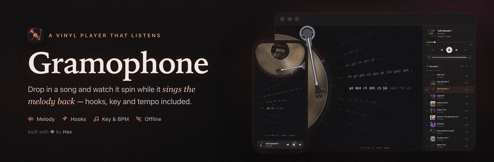
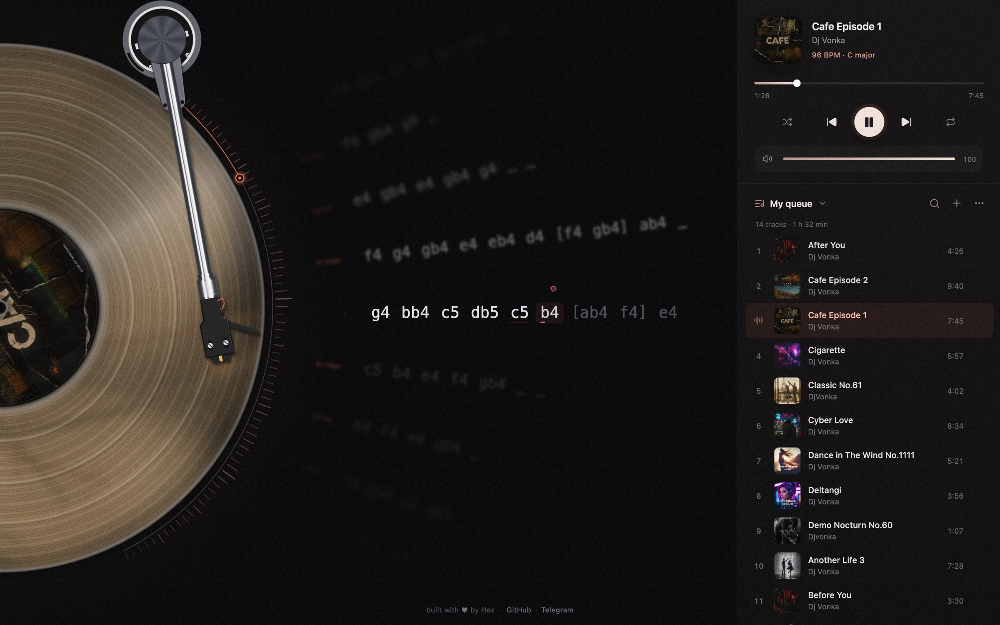
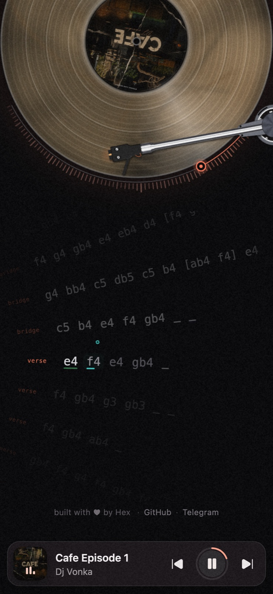
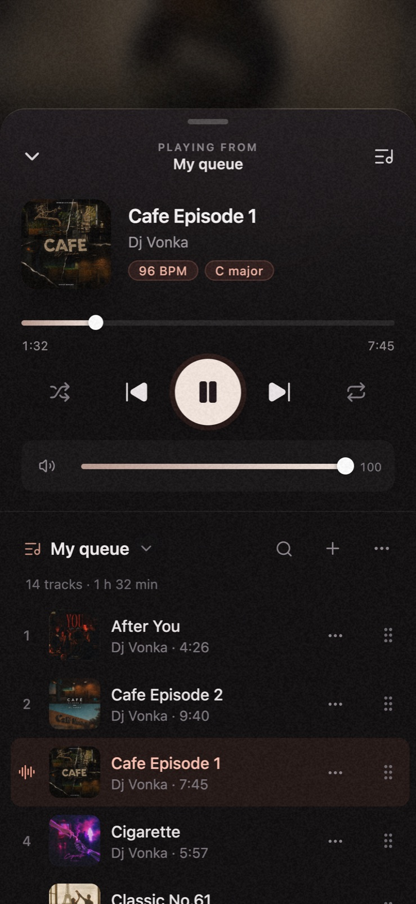

<p align="center">
  
</p>

<p align="center">
  <b>Drop in a song. Watch it play on a spinning record while Gramophone sings its melody back to you —<br>
  note by note, with the hooks, key and tempo worked out on your own device.</b>
</p>

<p align="center">
  <a href="#getting-started">Getting started</a> ·
  <a href="#android">Android</a> ·
  <a href="#how-it-works">How it works</a> ·
  <a href="#keyboard-shortcuts">Shortcuts</a>
</p>

---

<p align="center">
  
</p>
<p align="center">
  
  &nbsp;
  
</p>

## What it does

**It listens to the song**
- **Melody** — the lead line is tracked through the whole mix and written out as notes (`a4 c5 e5 …`), coloured by pitch, with a little marker hopping from note to note in time with the music.
- **Hooks & sections** — repeated phrases are found and labelled (intro, verse, hook, bridge…). When a real hook starts, the record and the line punch in and the light behind the record swells.
- **Key & tempo** — the song's key (e.g. *A minor*) and BPM, plus the big drum hits that drive the lighting.
- Everything is computed **locally**, in a background worker. Nothing is uploaded anywhere.

**It plays like a record**
- The record's colours come from the song's cover art; the cover becomes the label.
- A real tonearm (rendered in Three.js) cues, lowers and tracks the groove in sync with the audio; pausing brakes the platter and the sound together.
- Seeking backwards spins the record back with an actual backspin sound. Drag the ring around the record to scrub.
- A live spectrum ring and soft, film-grain lighting.

**It's a proper music player**
- Playlists, queue, shuffle, repeat one / all, play next, drag to reorder, search, volume.
- Add music by **dropping files or whole folders**, picking files (many at once on phones too), sharing songs to the installed app from Android's share menu, **pasting links** (single tracks, dozens of them, or `.m3u` / `.pls` playlists) or dragging a link in from another tab.
- **Duplicate detection** — the same file (even renamed) or the same link is never added twice.
- **Failure handling** — a track that can't be played (404, not audio, blocked by its host, corrupt) is flagged with the reason and skipped from then on; *Try again* is one tap away.
- **Fully offline** — your library lives in IndexedDB, link tracks are kept on the device after their first play, and the app itself is precached by a service worker.
- Everything is remembered: playlists, the track on the deck, the needle position, shuffle / repeat and volume.

**It runs everywhere**
- **Desktop & web** — installable as a PWA, with the window title bar hidden for a clean look.
- **Phones** — a stacked layout (the record hangs from the top), a floating glass mini player and a bottom-sheet player you can drag, with touch-friendly reordering.
- **Settings** — visual quality (Auto picks what the device can play smoothly; High / Balanced / Battery saver), film grain, and melody & beat analysis (off: songs start faster and a live visualizer takes the melody's place).
- **Diagnostics reports** — Settings › Help (or the first-run card when something fails) shares a structured report: device, app settings, library counts, the last phone scan and recent errors. Never song names or files.
- **Lock screen & notification** — a proper now-playing player on the lock screen, in quick settings and in the notification shade (cover art, seek bar, previous / play / next), plus headset and Bluetooth buttons. Music keeps playing with the screen off. In browsers the same controls go through the Media Session API.
- **Android app** — finds the music already on the phone (with a single "Music and audio" permission) and keeps an *On this phone* playlist in sync.

## Getting started

Requires **Node.js 20.19+** (or 22.12+).

```bash
npm install
npm run dev          # http://localhost:5183
```

```bash
npm run build        # type-check + production build into dist/
npm run preview      # serve the production build
```

The production build is a static site — host `dist/` anywhere (it registers a service worker, so serve it over HTTPS).

## Android

The Android app is a [Capacitor](https://capacitorjs.com) shell around the same web app, plus a small native plugin
([`MusicLibraryPlugin.java`](android/app/src/main/java/com/arminnotes/gramophone/MusicLibraryPlugin.java)) that reads the
phone's music library through Android's MediaStore.

**Requirements:** JDK 21 and the Android SDK (platform 36) — Android Studio installs both.

```bash
npm run android:apk      # debug APK → android/app/build/outputs/apk/debug/
npm run android:run      # build and launch on a connected phone or emulator
npm run android:release  # release APKs, one per CPU architecture + universal
```

- **Permissions:** `READ_MEDIA_AUDIO` on Android 13+ (`READ_EXTERNAL_STORAGE` on older versions) — music only, never all files.
- **Songs on the phone** are streamed straight from storage (no copies) with the full analysis; new songs are picked up each time the app opens.

### Releases

Android is built in the cloud by [`.github/workflows/android.yml`](.github/workflows/android.yml):

- **every push to `main` and every pull request** builds the signed APKs — download them from the run's
  **Artifacts** on the Actions tab;
- **a version tag** (or *Run workflow* with a version) also publishes a GitHub Release:

```bash
git tag v1.0.0
git push origin v1.0.0
```

Each release contains:

| File | For |
|---|---|
| `gramophone-<version>-arm64-v8a.apk` | almost every phone from the last ~8 years |
| `gramophone-<version>-armeabi-v7a.apk` | older 32-bit phones |
| `gramophone-<version>-x86_64.apk` · `-x86.apk` | emulators, Chromebooks, Intel tablets |
| `gramophone-<version>-universal.apk` | any device |
| `gramophone-<version>-web.zip` | the static web build |
| `SHA256SUMS.txt` | checksums |

Every architecture gets its own `versionCode` (`<build> × 10 + abi`), so updates always install the right file.
Gramophone has no native libraries today, so the per-architecture APKs are interchangeable; the split is there for
stores and for when native code arrives.

**Signing.** Add these repository secrets to sign releases with your own key (without them the APKs are signed with
a debug key: they install, but can't be updated in place by a differently signed build):

| Secret | Value |
|---|---|
| `ANDROID_KEYSTORE_BASE64` | `base64 -i release.jks` |
| `ANDROID_KEYSTORE_PASSWORD` | keystore password |
| `ANDROID_KEY_ALIAS` | key alias |
| `ANDROID_KEY_PASSWORD` | key password |

**Local release builds** sign with `android/signing/gramophone-release.jks` using the passwords in
`android/signing/keystore.properties` (both gitignored). Back that folder up — without the key, installed copies can
never be updated by a new build.

Don't have a key yet?

```bash
keytool -genkeypair -v -keystore android/signing/gramophone-release.jks -alias gramophone -keyalg RSA -keysize 4096 -validity 10000
```

## How it works

| Piece | What it does |
|---|---|
| **Melody** ([`melody.ts`](src/audio/melody.ts)) | STFT with spectral-peak enhancement → harmonic-sum pitch salience → Viterbi tracking with a jump penalty → voicing, tuning correction and note segmentation. YIN is the fallback for clean, monophonic audio. |
| **Tempo & hits** ([`tempo.ts`](src/audio/tempo.ts)) | Spectral-flux onsets → autocorrelation with a harmonic comb and a tempo prior; low-band flux picks out the big drum hits. |
| **Hooks & key** ([`phrases.ts`](src/audio/phrases.ts)) | Notes are grouped into lines; repeated phrases (by interval similarity) become hooks; the key comes from pitch-class profiles. |
| **Analysis worker** ([`analysis.worker.ts`](src/audio/analysis.worker.ts)) | All of the above off the main thread, so the record never stutters. |
| **Playback** ([`player.ts`](src/composables/player.ts)) | Web Audio graph with a deck state machine (cue → lower → play → brake / backspin) that keeps the arm, platter and sound in sync. |
| **Rendering** ([`VinylStage.vue`](src/components/VinylStage.vue)) | Canvas 2D record, ring and lighting; the tonearm is rendered once in Three.js into sprites. Shadows are pre-blurred so phones stay smooth. |
| **Library** ([`library.ts`](src/composables/library.ts)) | Playlists, play order, neighbour prefetch (the next and previous tracks are decoded ahead), links, duplicates, failure flags, IndexedDB persistence. |

## Keyboard shortcuts

| Key | Action |
|---|---|
| <kbd>Space</kbd> | play / pause |
| <kbd>←</kbd> <kbd>→</kbd> | seek 5 s |
| <kbd>↑</kbd> <kbd>↓</kbd> | previous / next melody line |
| <kbd>N</kbd> · <kbd>P</kbd> | next / previous track |
| <kbd>S</kbd> · <kbd>R</kbd> · <kbd>M</kbd> | shuffle · repeat · mute |
| <kbd>⌘</kbd> / <kbd>Ctrl</kbd> + <kbd>V</kbd> | add links or audio files from the clipboard |

## Project layout

```
src/
  audio/         analysis: melody, tempo, phrases & key, cover/tag reading, the worker
  components/    VinylStage (record), NoteLanes (melody), Sidebar (player + playlists), dialogs
  composables/   player, library, persistence, links, layout, native (Android) bridge
  render/        record textures, cover palettes, Three.js tonearm
public/          manifest, service worker, icons
android/         Capacitor Android project (+ the MusicLibrary plugin)
design/          icon source and the banner artwork (banner.html)
scripts/         icon, Android icon and banner generators
```

| Script | |
|---|---|
| `npm run icons` | PWA icons from `design/icon-source.png` |
| `npm run icons:android` | Android launcher icons + splash |
| `npm run banners` | README banner + social preview from `design/banner.html` |

## Privacy

Gramophone has no server, no accounts and no analytics. Your music and its analysis stay on your device. The only
network requests it makes are the links you add (to download them) — and nothing at all once a link has been saved for
offline.

## License

[CC BY 4.0](LICENSE) — you're free to share and adapt Gramophone, including commercially, as long as you give
appropriate credit (*Gramophone by Hex*, with a link back to this repository) and indicate if changes were made.

---

<p align="center"><sub>Built with ♥ by <a href="https://github.com/RealMrHex/">Hex</a> · <a href="https://t.me/MentionHex">Telegram</a></sub></p>
